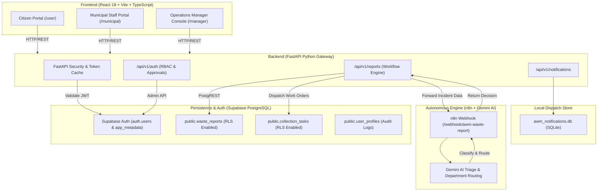

# AWM Agent — Architectural Overview

## 1. System Vision

The **Autonomous Waste Management (AWM) Agent** is an enterprise-grade civic infrastructure platform designed to automate municipal sanitation workflows. It bridges citizen complaint reporting, real-time AI hazard classification, field fleet dispatch, and supervisory SLA verification into a unified municipal operating system.

---

## 2. High-Level Architecture Diagram

---

## 3. Core Component Responsibilities

### 3.1. Frontend Web Application (`/frontend`)
* **Role-Based Portals**: Dedicated portals for Citizens, Municipal Staff, and Operations Managers with route guards (`ProtectedRoute.tsx`).
* **Authentication UI**: Unified, branded login card with password and Google OAuth authentication gateways.
* **Map Incident Visualization**: Leaflet / OpenStreetMap visualizers showing geolocated incidents across wards.
* **Incident Lifecycle Timeline**: Interactive tracking from submission to field clearance.

### 3.2. Backend REST API Gateway (`/backend`)
* **FastAPI Microservices**: Asynchronous request handling with dependency injection for token verification.
* **Security & Token Cache (`security.py`)**: High-performance in-memory caching (30s TTL) to reduce redundant Supabase roundtrips while preserving server-side role authority.
* **Report Workflow Engine (`reports.py`)**: Enforces state machine transitions (Submitted $\rightarrow$ Assigned $\rightarrow$ In Progress $\rightarrow$ Resolution Submitted $\rightarrow$ Resolved).
* **Notification Engine (`notifications.py` & `notification_service.py`)**: Dispatches alerts to local persistent store.

### 3.3. Supabase Cloud PostgreSQL
* **Supabase Auth (`auth.users`)**: Manages identity, verified emails, and server-controlled `app_metadata` (the trusted source of truth for user roles).
* **Row-Level Security (RLS)**: Enforces database-level isolation so Citizens only see their own reports, while Municipal Staff only see tasks assigned to their vehicle/email, and Managers supervise all department records.
* **Relational Schema**: Tables `waste_reports`, `collection_tasks`, and optional `user_profiles`.

### 3.4. n8n Autonomous AI Decision Engine (`/automation`)
* **Hazard & Material Classification**: Analyzes waste descriptions and locations.
* **Urgency Scoring**: Categorizes reports into `LOW`, `MEDIUM`, or `HIGH` priority based on drainage blockage, health hazards, and public safety.
* **Automated Department Dispatch**: Determines whether an incident belongs to Solid Waste Management, Cleansing, or Public Health.

---

## 4. 8-Stage Incident Resolution Lifecycle

Every civic waste incident moves through strict lifecycle stages:

1. **SUBMITTED**: Citizen submits report with photo and location coordinates.
2. **AI_CLASSIFIED**: n8n AI engine assigns urgency score, waste category, and recommended department.
3. **UNDER_REVIEW**: Initial triage by municipal intake.
4. **ASSIGNED**: Operations Manager designates a specific field staff member or sanitation crew vehicle.
5. **ACCEPTED**: Staff member confirms task receipt in the field.
6. **IN_PROGRESS**: Cleansing operations commenced on site.
7. **RESOLUTION_SUBMITTED**: Staff uploads clearance notes and completion proof.
8. **RESOLVED**: Operations Manager conducts supervisory audit and verifies resolution.
